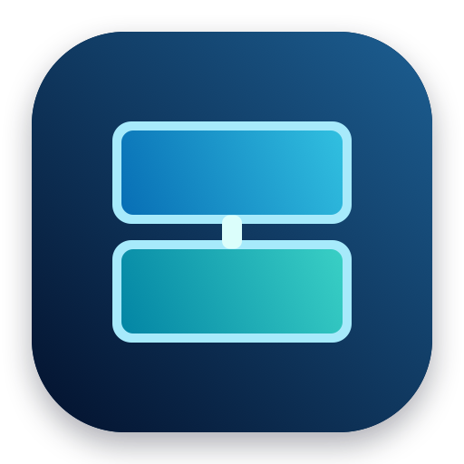

# X1 Air Display Sync

<p align="center"></p>

[简体中文](README.md)

**X1 Air Display Sync** is a macOS menu bar utility for the **EHOMEWEI X1 Air** stacked dual-screen portable monitor. One control writes the selected setting to both physical panels and shows what each panel reports back.

## Why it exists

With one full-featured USB-C cable in Sequence mode, this X1 Air presents a single **2520 × 3360** desktop to macOS. In testing, standard DDC/CI brightness commands on that video connection changed the bottom panel only. The two physical panels have separate USB HID interfaces. This app uses both interfaces to update their hardware settings together.

The app can also recover a specific macOS black-screen issue where a connected X1 Air disappears from Displays settings. macOS can save the screen in `IndependentOutput` mode, which keeps it outside the extended desktop even after a restart.

## Compatibility

| Component | Tested setup and requirements |
| --- | --- |
| Monitor | EHOMEWEI **X1 Air**, two 14.2-inch 2520 × 1680 panels |
| Mac | Apple silicon. Tested on an **M4 Mac mini** |
| macOS | Build targets macOS 14 or later. Tested on **macOS 27.2** |
| Connection | One USB-C cable carrying DisplayPort video and USB data, with the X1 Air in Sequence mode |
| Other setups | X2 Air, X1 Pro, X2 Pro, Intel Macs, HDMI-only setups and multiple X1 Air units are unverified |

See the [manufacturer’s X1 Air product page](https://www.ehomewei.com/products/x1-air).

## Features

- Sync brightness, contrast, hue, saturation and color temperature or color presets.
- Sync custom RGB, picture modes, dynamic contrast and eye comfort mode.
- Check each panel’s current value. If a write fails, the app attempts to restore the prior values and refreshes the readings.
- Compare grayscale and color patches on both panels and an optional reference display.
- Keep the app in the menu bar and optionally launch it when you log in.
- Recover the X1 Air as an extended display when macOS has left it in independent output mode.

The HDR readback was inconsistent across panels during testing. Use the monitor’s on-screen display for HDR.

## Build and use

Build on Apple silicon with Xcode or Command Line Tools that include Swift and the macOS SDK.

```bash
git clone https://github.com/StephenMelon/x1-air-display-sync.git
cd x1-air-display-sync
./build.sh
open ".build/X1 Air Display Sync.app"
```

The build is ad hoc signed. For regular use or login startup, move the app to **Applications** first.

1. Click the stacked-screen icon in the macOS menu bar and choose **打开双屏调节…** (Open display controls).
2. Select a setting under **调节项目** (Setting). Release the slider or enter a value and press Return to apply it to both panels.
3. Look at **右上屏** (top panel) and **右下屏** (bottom panel) for the readback. Use **显示对比色块** (Show comparison patches) to compare how the same colors look.
4. Choose the **自定义 RGB** color preset before adjusting RGB.
5. To start the app at login, check **登录时启动** (Launch at login) in the menu bar menu. macOS manages this state and may ask you to approve the item in System Settings. [Apple login item documentation](https://developer.apple.com/documentation/servicemanagement/smappservice/mainapp)

Switching color presets or picture modes can change other values in the monitor’s firmware. The app reloads the settings after applying a change.

## Troubleshooting

- **The X1 Air is black and `Monitor` is missing from Displays settings.** Keep the X1 Air directly connected over USB-C in Sequence mode. Open the menu bar icon and choose **恢复右屏扩展…** (Restore extended display). The menu item appears when the app verifies the USB panel identities, the video output, and the saved independent-output state. Clicking it restores the matching X1 Air and verifies that it rejoins the desktop as an extension. The app also attempts to restore the last scaling it recorded for that display.
- **Video works but the controls are unavailable.** Try a direct USB-C cable that supports video and USB data. Check that macOS lists the monitor and that both panels are on, then click Refresh.
- **Reference brightness is unavailable.** The reference display may not expose its brightness over DDC/CI on that connection. You can read it from the monitor menu or compare the test patches visually.
- **The same setting looks different on the two panels.** The readings are hardware settings. Viewing angle, preset and panel characteristics affect the light you see.

Extended display recovery was verified on an **M4 Mac mini running macOS 27.2**, with the X1 Air connected via USB-C in Sequence mode. Recovery uses a private macOS SkyLight API, so availability may change with macOS releases. [Independent output reproduction](https://www.cheverjohn.me/macos-26-stop-extending-blanked-my-monitor-fixing-windowserver-independentoutput)

To report a compatibility issue, include the product model, macOS version, connection and display mode. This command prints the available control values:

```bash
".build/X1 Air Display Sync.app/Contents/MacOS/X1AirDisplaySync" --status
```

## Source and license

SwiftUI draws the controls, AppKit supplies the menu bar item, and Service Management registers login startup. The monitor layer uses IOKit USB HID for the X1 Air and DDC/CI to attempt a brightness read on the reference display. The DDC/CI code includes MIT-licensed components from [m1ddc](https://github.com/waydabber/m1ddc) in `Vendor/m1ddc`.

`Sources/App/DisplayRecovery.swift` reads WindowServer's saved display configuration, matches the video output to the physical panels, and restores desktop output in a display configuration transaction.

Released under the [MIT license](LICENSE).
