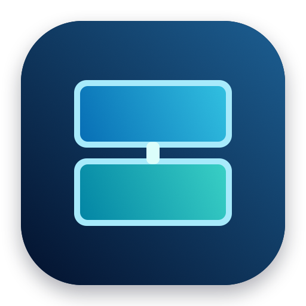

# X1 Air Display Sync

<p align="center"></p>

[English](README.en.md)

**X1 Air Display Sync** 是一个 macOS 菜单栏应用，用于同步调节一泓微（EHOMEWEI）**X1 Air** 折叠双屏。一个滑块可以同时调节上下两块面板，应用分别读回两块屏的设置值。

## 解决什么问题

X1 Air 在一根 USB-C 线连接 Mac 的瀑布模式下，会向 macOS 提供一个竖向桌面。实测系统显示为 `Monitor`，分辨率为 **2520 × 3360**。这条视频链路的标准 DDC/CI 亮度命令只调节下屏，使用通用 DDC 工具时，上屏可能维持原来的亮度。

本应用通过 USB HID 识别 X1 Air 的两块物理面板，分别发送同一项设置。每次操作后，窗口会显示上屏和下屏各自回报的值。

## 适用硬件与接线

| 项目 | 支持及验证情况 |
| --- | --- |
| 显示器 | 一泓微 EHOMEWEI **X1 Air**，14.2 英寸上下折叠双屏，单屏 2520 × 1680 |
| Mac | Apple 芯片，实测 **M4 Mac mini** |
| macOS | 构建目标为 **macOS 14 或更新版本**，硬件实测为 **macOS 27.2** |
| 接线 | 实测为一根支持 **视频和 USB 数据** 的全功能 USB-C 线，双屏用瀑布模式 |
| 其他型号和接法 | X2 Air、X1 Pro、X2 Pro、Intel Mac、纯 HDMI 接线及多台 X1 Air 组合待验证 |

将全功能 USB-C 线接到 Mac 的视频输出口。应用同时需要视频输出和 USB 数据，以便把两路面板控制接口与 macOS 中的 X1 Air 对应起来。建议首次使用时只连接一台 X1 Air。 [一泓微 X1 Air 产品页](https://www.ehomewei.com/products/x1-air)

## 功能

- 同步亮度、对比度、色调、饱和度、色温与色彩预设。
- 支持自定义 RGB、画面模式、动态对比度和护眼模式。
- 查看上下屏实际回报的值。同步失败时，应用尝试恢复本次操作前的值，并重新读取可用结果。
- 显示黑白灰阶与彩色色块，便于对照两块面板和另一台参考屏。
- 从 macOS 菜单栏打开调节窗口。可在同一菜单中勾选「登录时启动」。

HDR 切换在这套设备上出现过回读不一致，HDR 可通过显示器机身菜单调节。

## 构建和运行

需要 Apple 芯片 Mac，以及带有 macOS SDK 和 Swift 编译器的 Xcode 或 Command Line Tools。

```bash
git clone https://github.com/rainb0w-light/x1-air-display-sync.git
cd x1-air-display-sync
./build.sh
open ".build/X1 Air Display Sync.app"
```

编译后的应用位于 `.build/X1 Air Display Sync.app`，构建脚本使用本机临时签名。需要日常使用或开启登录启动时，可以先在 Finder 中把应用移到「应用程序」。

## 如何使用

1. 启动应用后，点击屏幕顶部菜单栏里的双屏图标，选择「打开双屏调节」。
2. 在「调节项目」里选择亮度、对比度等选项。拖动滑块后松手，或输入数值后按回车。
3. 查看「右上屏」和「右下屏」的回读值。按「显示对比色块」可以在相同内容下判断实际观感。
4. 要调 RGB，先把「色温与色彩预设」切换为「自定义 RGB」。
5. 要在下次登录以后自动启动，打开菜单栏图标并勾选「登录时启动」。勾选状态以 macOS 登录项为准。需要批准时，菜单会提供系统设置入口。应用登录后会在菜单栏出现，调节窗口按需打开。 [Apple 登录项接口说明](https://developer.apple.com/documentation/servicemanagement/smappservice/mainapp)

调色温或画面模式后，显示器固件可能同时刷新 RGB 或其他画面参数。应用会重新读取设置。

## 常见问题

### macOS 看到了画面，应用却读不到面板

换用支持 USB 数据和视频输出的全功能 USB-C 线，并在「系统设置 → 显示器」确认 X1 Air 已启用。两个面板都开机后，点调节窗口的刷新按钮。如果使用了纯 HDMI 或只转发视频的转接器，请先用 USB-C 直连复测。

### 参考屏显示「无法读取亮度」

参考屏的亮度通过 DDC/CI 尝试读取，结果取决于显示器与连接方式。可以查看参考屏机身菜单里的亮度数值，填入应用，或打开色块按观感比较。

### 色调读数一样，为什么两块看起来还是有差别

硬件菜单值是设定值，实际观感还会受面板、色彩预设、视角和环境光影响。建议用「显示对比色块」先确认两块屏的白色和灰阶表现。

### 怎么检查硬件识别

应用内可用刷新按钮，也可在终端运行只读诊断：

```bash
".build/X1 Air Display Sync.app/Contents/MacOS/X1AirDisplaySync" --status
```

提交兼容性问题时，可以附上显示器型号、macOS 版本、接线方式、显示模式和上述读数，以及机身菜单中的固件版本（若可见）。

## 实现与许可证

- `Sources/App` 使用 SwiftUI 绘制调节窗口，使用 AppKit 提供菜单栏图标，通过 `SMAppService` 管理登录项。
- `Sources/Monitor` 通过 IOKit 查询 USB HID 的型号、面板角色和亮度等设置。应用根据设备回报识别上屏与下屏，并匹配当前显示输出。
- `Scripts/GenerateIcons.swift` 生成应用图标与菜单栏模板图标。
- `Vendor/m1ddc` 包含读取参考屏 DDC/CI 亮度所用的源码及其 MIT 许可。 [m1ddc](https://github.com/waydabber/m1ddc)

本项目采用 [MIT 许可证](LICENSE)。
